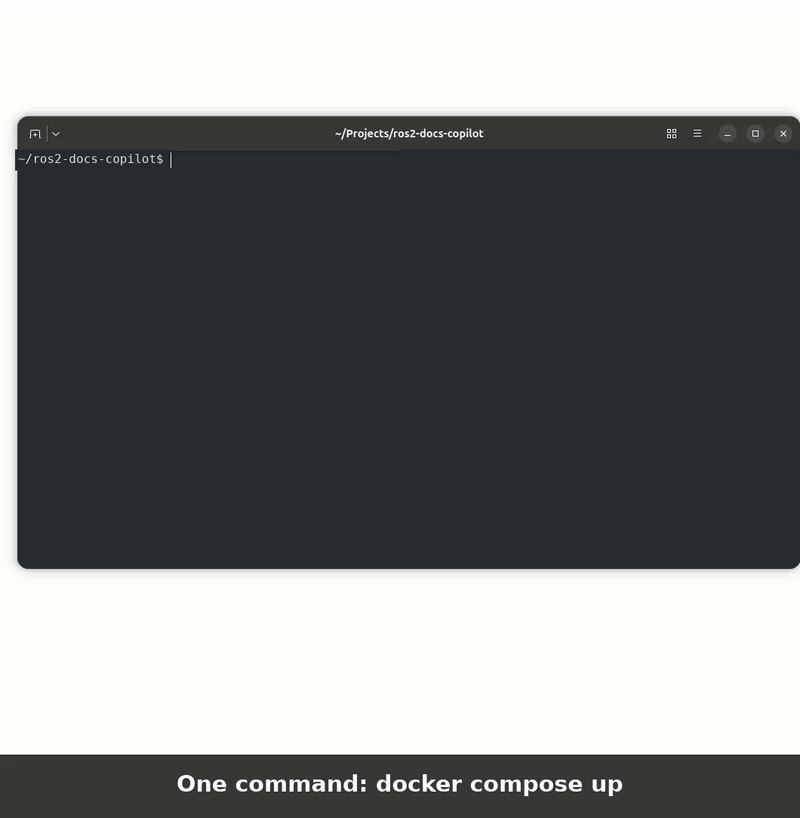
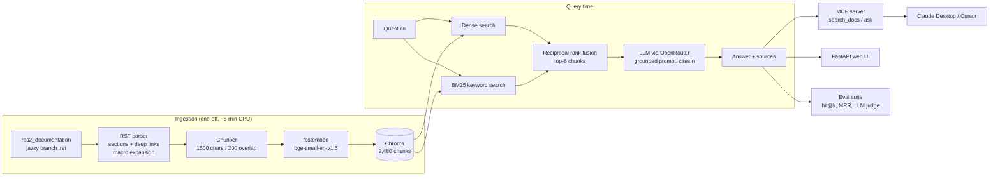

# ROS 2 Docs Copilot

A retrieval-augmented (RAG) agent over the official **ROS 2 Jazzy documentation** that answers robotics developer questions **with citations to docs.ros.org**. It's exposed as an **MCP server** for Claude Desktop and Cursor, plus a small web UI, and it ships with an **eval suite** that reports real numbers.



> Ask: *"How do I make turtle_teleop_key control turtle2?"*
> Get: the exact `--ros-args --remap …` command, with a `[1]` citation that links to the tutorial section it came from.

## Features

- **Ingestion**: parses the reStructuredText source of `ros2/ros2_documentation` (Jazzy branch). It covers 234 pages (Tutorials, Concepts, How-To Guides, Installation, Glossary), split into 2,480 section-aware chunks, each with a deep link (`page.html#section`). Sphinx macros like `{DISTRO}` are expanded.
- **Hybrid retrieval**: dense embeddings (`BAAI/bge-small-en-v1.5`, run locally on CPU via fastembed) plus BM25 keyword search, merged with reciprocal rank fusion. The index lives in Chroma on disk.
- **Grounded answers**: the LLM (any OpenRouter model, `gpt-4o-mini` by default) must answer only from the retrieved excerpts and cite them as `[n]`.
- **MCP server** with two tools: `search_docs` (raw ranked excerpts, no LLM cost) and `ask` (a cited answer).
- **FastAPI web UI and JSON API**: `/api/ask`, `/api/search`, `/api/health`.
- **Evals**: 30 hand-written Q&A pairs checked against the docs. They measure retrieval hit-rate@k and MRR, and score answer accuracy with an LLM judge.
- **One-command run** with Docker Compose.

## Architecture



## Quick start (one command)

```bash
cp .env.example .env        # then add your OPENROUTER_API_KEY
docker compose up --build   # http://localhost:8000
```

On first start the container clones the docs and builds the index into `./data` (about 5–7 minutes on CPU). Later starts are instant.

**Without Docker** ([uv](https://docs.astral.sh/uv/)):

```bash
uv sync
uv run copilot-ingest     # build the index
uv run copilot-web        # http://127.0.0.1:8000
```

## Use it from Claude Desktop / Cursor (MCP)

Add this to `claude_desktop_config.json` (or Cursor's `mcp.json`):

```json
{
  "mcpServers": {
    "ros2-docs": {
      "command": "uv",
      "args": ["--directory", "/path/to/ros2-docs-copilot", "run", "copilot-mcp"]
    }
  }
}
```

The Docker alternative is `"command": "docker", "args": ["compose", "-f", "/path/to/ros2-docs-copilot/docker-compose.yml", "--profile", "mcp", "run", "--rm", "-T", "mcp"]`.

Then ask Claude something like *"Use ros2-docs to find how to set QoS durability to transient local"*.

## Evaluation

`evals/qa.jsonl` holds 30 questions written by hand. Each one has a reference answer and the docs pages that contain it, checked by grepping the source. They cover the CLI, colcon, rosbag2, QoS, tf2, executors and callback groups, composition, launch, RMW and discovery.

- **hit@k**: the share of questions where at least one of the top-k chunks comes from a labelled relevant page.
- **MRR@5**: mean reciprocal rank of the first relevant chunk.
- **Accuracy**: an LLM judge compares each answer with the reference and returns CORRECT, PARTIAL or INCORRECT.
- **Citation rate**: the share of answers with at least one `[n]` citation.

### Results (2026-11-13, n = 30, answer and judge model `openai/gpt-4o-mini`)

| Version | hit@1 | hit@3 | hit@5 | MRR@5 | Correct | Correct + partial | Cited | Median latency |
|---|---|---|---|---|---|---|---|---|
| v1: dense only, raw macros, strict prompt | 0.833 | 0.967 | 0.967 | 0.883 | 20/30 (66.7%) | 86.7% | 86.7% | 2.6 s |
| v2: dense only, macros expanded, revised prompt | 0.800 | 0.967 | 0.967 | 0.861 | 23/30 (76.7%) | 90.0% | 90.0% | 3.0 s |
| **v2: hybrid (dense + BM25), default** | 0.833 | 0.933 | 0.933 | 0.878 | **23/30 (76.7%)** | **93.3%** | **100%** | 3.5 s |

Raw per-question outputs are in `evals/results/`.

**What changed between v1 and v2.** Error analysis on v1 found two real issues:

1. Sphinx macros such as `--rosdistro {DISTRO}` were leaking into answers. They are now expanded at ingest time.
2. Four answers wrongly said "couldn't find this". For example, `ros2 interface show` was shown for one message type, and the model would not apply it to another. The prompt now allows adapting general commands from the excerpts.

Hybrid BM25 did **not** improve page-level retrieval on this set. It did give fewer wrong answers and 100% citations, so it is the default. Both modes can be compared with `--mode`.

**Honest caveats**

- 30 questions is a small set, so a difference of one question is 3.3 points.
- The LLM judge is imperfect. In the hybrid run it marked "goal, result, feedback" as wrong because the order differed from the reference.
- The labels were written by the same person who built the system.

Run them yourself:

```bash
uv run python evals/run_evals.py                       # hybrid (default), needs the API key
uv run python evals/run_evals.py --mode dense --tag dense
uv run python evals/run_evals.py --retrieval-only      # free, no LLM calls
# or: docker compose --profile eval run --rm eval --mode hybrid --tag hybrid
```

## Configuration (`.env`)

| Variable | Default | Notes |
|---|---|---|
| `OPENROUTER_API_KEY` | (none) | required for `ask` and the evals |
| `LLM_MODEL` / `JUDGE_MODEL` | `openai/gpt-4o-mini` | any OpenRouter model id |
| `RETRIEVAL_MODE` | `hybrid` | or `dense` |
| `TOP_K` | `6` | chunks passed to the LLM |
| `ROS_DISTRO_DOCS` | `jazzy` | docs branch to index (re-run ingest) |

## Project layout

```
copilot/
  ingest.py      # clone -> parse .rst -> chunk -> embed -> Chroma
  store.py       # Chroma client + fastembed embeddings
  rag.py         # hybrid search (dense + BM25 + RRF) and cited answer generation
  mcp_server.py  # MCP tools: search_docs, ask (stdio)
  web.py         # FastAPI app + static/index.html UI
evals/
  qa.jsonl       # 30 hand-written Q&A pairs with relevant pages
  run_evals.py   # hit@k, MRR, LLM-as-judge accuracy, citation rate
  results/       # summaries + per-question outputs
docs/demo.gif        # 30 s demo (docs/demo-script.md = shot list)
```

## Limitations and next steps

- Only the text of the docs is indexed: no package API docs (`/p/<pkg>`) and no images.
- Possible improvements: a cross-encoder reranker, query rewriting for multi-hop questions, a larger eval set with a second annotator, and streaming answers in the UI.

Docs content © Open Robotics, licensed CC BY 4.0, from [ros2/ros2_documentation](https://github.com/ros2/ros2_documentation).
